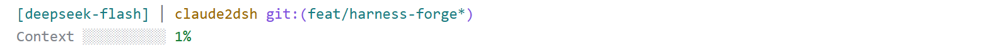

# Harness Forge adapters

[中文](#中文)

DSH adapters: small plugins that bring a part of a Claude Code, Codex or OpenCode plugin to DeepSeek Harness (DSH) when DSH cannot run that part as it is. Each adapter here was written by the AI inside DSH in the porting studio of [Harness Forge](https://github.com/kirkchinese/claude2dsh), checked and tried there, and then verified in a real DSH window before it was listed.

An adapter does not copy the original plugin. It runs beside the original, which stays where you installed it, and calls the original's own code. See [SECURITY.md](SECURITY.md) for what that means.

## Adapters

| Adapter | Brings | Original | Verified |
|---|---|---|---|
| [claude-hud-statusline](adapters/claude-hud-statusline) | claude-hud's status line, computed by claude-hud itself, below the DSH composer | [jarrodwatts/claude-hud](https://github.com/jarrodwatts/claude-hud) @ `dd8c0be` (MIT) | `node --test`, porting-studio check and trial, a DSH Web window in light and dark themes |



## Install

Add this repository's market index in DSH's plugin market:

```
https://raw.githubusercontent.com/kirkchinese/harness-forge-adapters/main/index.json
```

or install one adapter from the command line (here into the `web` profile):

```sh
dsh plugin --profile web add "git+https://github.com/kirkchinese/harness-forge-adapters.git#<commit>&path:/adapters/claude-hud-statusline"
```

`<commit>` is the commit `index.json` lists for the adapter. The adapters are not on npm yet.

## What each adapter directory holds

| File | |
|---|---|
| `README.md` | what it restores, how to install it, every remaining difference |
| `PUBLISH.md` | the original plugin, its commit and license, the model and porting-prompt version that wrote it, the latest check and trial |
| `port.json` | the porting record: the gap, the original, the run, every check and trial |
| `index.js`, `client.js`, `plugin-root.js` | the adapter |
| `test/` | its tests (`node --test`), not installed |

## Development

```sh
npm ci
npm test              # every adapter's tests
npm run check-index   # index.json against DSH's own validator
npm run index -- --commit <sha>   # rebuild index.json for adapters at <sha>
```

## License

The adapters are MIT-licensed (see each directory's `LICENSE`). The original plugins keep their own licenses; adapters ship none of their files.

---

# 中文

DSH 适配器：当 DSH 无法原样运行 Claude Code、Codex 或 OpenCode 插件的某个部分时，用一个小插件把这个部分带进 DeepSeek Harness（DSH）。这里收录的每个适配器，都由 DSH 里的 AI 在 [Harness Forge](https://github.com/kirkchinese/claude2dsh) 的移植工作室中编写，经过工作室的检查和隔离试装，并在真实 DSH 窗口中核验后才收录。

适配器不复制原插件：原插件留在你安装它的位置，适配器在旁边运行，并调用原插件自己的代码。这意味着什么，见 [SECURITY.md](SECURITY.md)。

## 适配器

| 适配器 | 带来的能力 | 原插件 | 核验 |
|---|---|---|---|
| [claude-hud-statusline](adapters/claude-hud-statusline) | claude-hud 的状态栏，由 claude-hud 自己计算，显示在 DSH 输入框下方 | [jarrodwatts/claude-hud](https://github.com/jarrodwatts/claude-hud) @ `dd8c0be`（MIT） | `node --test`、工作室检查与试装、DSH Web 窗口浅色和深色主题 |

## 安装

在 DSH 插件市场中添加本仓库的索引：

```
https://raw.githubusercontent.com/kirkchinese/harness-forge-adapters/main/index.json
```

或者用命令行安装单个适配器（此处装进 `web` profile）：

```sh
dsh plugin --profile web add "git+https://github.com/kirkchinese/harness-forge-adapters.git#<commit>&path:/adapters/claude-hud-statusline"
```

`<commit>` 是 `index.json` 为该适配器列出的 commit。适配器暂未发布到 npm。

## 每个适配器目录里有什么

| 文件 | |
|---|---|
| `README.md` | 它恢复了什么、怎么安装、所有仍然不同的地方 |
| `PUBLISH.md` | 原插件及其 commit 和许可证、编写它的模型与移植提示词版本、最近一次检查与试装 |
| `port.json` | 移植记录：缺口、原插件、运行信息、每次检查与试装 |
| `index.js`、`client.js`、`plugin-root.js` | 适配器本身 |
| `test/` | 测试（`node --test`），不随包安装 |

## 开发

```sh
npm ci
npm test              # 所有适配器的测试
npm run check-index   # 用 DSH 自带的校验器检查 index.json
npm run index -- --commit <sha>   # 按 <sha> 处的适配器重建 index.json
```

## 许可证

适配器使用 MIT 许可证（见各目录的 `LICENSE`）。原插件保留各自的许可证；适配器不包含原插件的任何文件。
