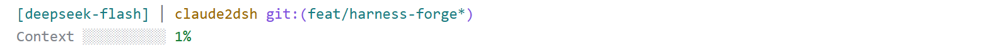
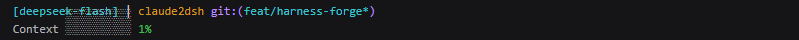

# claude-hud for DSH: the status line

A DSH adapter that restores **claude-hud**'s status line in DSH. It runs beside the claude-hud
already installed on this machine and reuses that install's own `hud.mjs`; the plugin is not copied,
modified or bundled.





## What it restores

In Claude Code, claude-hud's `statusLine` command is `node hud.mjs`. Claude Code writes a JSON
payload about the session to its stdin, and hud.mjs prints coloured status lines to stdout. DSH
shows those lines below the composer: the model, the project directory and its git branch on the
first line, then the context bar with its percentage (`Context ███░░░░░░░ 27%`), plus whatever else
the user's claude-hud config turns on.

claude-hud computes the content and its ANSI styling. The adapter builds the payload Claude Code
would have written from the facts DSH records for the session (model, context window, the last
request's uncached and cached input tokens, the working directory), pipes it into the plugin's own
`hud.mjs`, and hands the printed lines to the browser. The client maps claude-hud's ANSI styling to
spans and lays the lines out; it does not recompute the HUD's content.

## Install

From npm:

```sh
dsh plugin --profile web add @kirkchinese/dsh-adapter-claude-hud-statusline
```

or from the [community repository](https://github.com/kirkchinese/harness-forge-adapters), at the
commit its README and its plugin market index (`index.json`) list:

```sh
dsh plugin --profile web add "git+https://github.com/kirkchinese/harness-forge-adapters.git#<commit>&path:/adapters/claude-hud-statusline"
```

Replace `web` with the DSH profile you use. A DSH profile with the plugin market can also add the
repository's index, `https://raw.githubusercontent.com/kirkchinese/harness-forge-adapters/main/index.json`,
and install it from there.

claude-hud itself is not bundled. The adapter looks for it on this machine, on every render, in this
order (`plugin-root.js`):

1. `$CLAUDE_HUD_ROOT`, when set;
2. a claude-hud imported into any DSH profile by Harness Forge;
3. Claude Code's install: `~/.claude/plugins/installed_plugins.json`, the newest valid `installPath`;
4. Codex's install: `~/.codex/plugins/cache/<marketplace>/claude-hud/<version>`, the newest;
5. an OpenCode install: `~/.config/opencode/plugins/claude-hud` or `./.opencode/plugins/claude-hud`.

A candidate only counts when it actually holds `hud.mjs` (a file). A missing, stale, malformed or
unreadable source is skipped and the next one is tried, so a stale `CLAUDE_HUD_ROOT` or a stale
Claude Code record does not hide a valid install found later. An ordinary claude-hud install needs
no configuration. Because the lookup happens on every render, installing or moving claude-hud later
needs no DSH restart.

If no root with `hud.mjs` is found, the dock does not go blank and nothing crashes: it shows one line,
`claude-hud: not installed. Install it for Claude Code, or set CLAUDE_HUD_ROOT to its folder (the
one holding hud.mjs).`

### Requirements

- DSH `0.2.1-rc.2` up to (not including) `0.3.0`.
- Node 22.18 or later for claude-hud.

DSH Desktop runs plugins under Electron, where `process.execPath` is the Electron binary. claude-hud
re-launches `process.execPath` inside its own cage, so starting it with Electron would fail. The
adapter detects Electron and starts `hud.mjs` with a real Node found on `PATH`, checking that its
version is 22.18 or later. It never hands the HUD to Electron. If no suitable Node is on `PATH`, the
dock draws a clear message instead. Under a normal Node DSH, the adapter uses the runtime DSH runs on
when it meets the same floor.

## Security: it runs code

The adapter runs the installed claude-hud's own code (its `hud.mjs` and the plugin files it loads)
with the permissions of your DSH process. Install only a claude-hud you trust. `CLAUDE_HUD_ROOT`
selects executable code: point it only at a folder you trust. claude-hud's own cage applies its
permission model to its logic, but that is claude-hud's boundary, not an additional one added by this
adapter.

## Where it shows

Web and Desktop DSH draw the lines in `conversation.composer.dock`, below the composer. The dock is a
flex row shared with DSH's own statistics; the adapter makes the dock wrap and gives the HUD a
full-width row of its own, so the two lines are not squeezed into a strip beside those statistics.

The colours follow the active DSH theme: the client reads DSH's dark marker (`body[data-ds-dark-theme]`)
and the root `color-scheme`, with `prefers-color-scheme` only as a fallback. The light and dark
palettes are tested terminal palettes. SGR dim is drawn as a muted colour (the DSH tertiary label
where it exists), not as reduced opacity, so the empty part of the context bar stays visible on the
light theme.

Headless DSH has no window and renders nothing by default.

## Configuration

claude-hud's own config applies, because claude-hud reads it: `config.json` under
`$CLAUDE_CONFIG_DIR/plugins/claude-hud/` (default `~/.claude/plugins/claude-hud/config.json`) and
`claude-hud.json` under `$CLAUDE_CONFIG_DIR` (default `~/.claude/claude-hud.json`; its keys win).
Changing `display.showContextBar`, `display.contextValue`, `colors.*`, `lineLayout`, `language`, and
the rest changes what DSH draws too. `CLAUDE_HUD_DISABLE=1` blanks it, as in Claude Code.

## Diagnostic: last-render.json

Off by default. Set `CLAUDE_HUD_STATUSLINE_LAST_RENDER=1` (or `true`, `yes`, `on`) to make the
adapter render in headless DSH too and write its latest render to:

```
$DSH_HOME/harness-forge/adapter-data/claude-hud-statusline/last-render.json
```

The file is written atomically (temporary file, then rename) and is scoped to the render it came
from: it names the DSH profile and the session, and carries the lines, the payload sent to
claude-hud, the session facts, the column count, the time and any error. It holds only the latest
render.

`harness_port_trial` reads this file. For its own scratch session only, the trial harness sets
`HARNESS_FORGE_TRIAL=1`, which also turns the diagnostic on; that variable is set by the trial, not
by DSH, so a normal session never sees it. No credential or other environment variable enables the
diagnostic: a real `DEEPSEEK_API_KEY` (or any other key) leaves it off. In everyday use, set
`CLAUDE_HUD_STATUSLINE_LAST_RENDER=1` if you want the file.

## What still differs

- **No transcript.** Claude Code passes `transcript_path`; DSH's session log is a different format,
  so it is not passed. Everything claude-hud derives from the transcript stays empty or hidden:
  tool activity, skills, MCP servers, subagents, todos, session tokens, compactions, session start,
  last response, `display.modelSource` set to `transcript`, and the `effort` line's ultracode
  marker. Enabling those elements will not make them appear.
- **No subscription usage.** DSH does not report Claude's 5-hour / 7-day rate limits, so
  `rate_limits` is absent and the usage line is hidden (claude-hud hides it when there is no data).
- **No cost, duration or version.** `cost`, `session_name`, `version` and `output_style` are
  Claude Code's own payload fields; they are not passed, so elements that need them stay hidden or
  empty.
- **Context percentage.** It is claude-hud's own figure for the last request
  (input + cache read + cache write ÷ context window). Before the first assistant message of a
  session there are no token counts, so the bar reads 0%. After `/compact` in DSH there is no
  transcript fallback, so it reads the last request until the next one lands.
- **Model.** DSH records the model on `model/selection` (session start and model switches) and, when
  no selection has been recorded, falls back to the route folded from the latest `request/context`;
  `[Unknown]` shows only until DSH has recorded one of those.
- **Links.** claude-hud renders the project path and a GitHub branch as OSC 8 hyperlinks. The dock
  keeps their coloured text and drops the link target.
- **Styling.** SGR colour, bold, dim, italic and underline are mapped to spans. Other SGR attributes
  (blink, strike-through, overline) and every non-SGR escape sequence are dropped; claude-hud's own
  terminal filter already removes the latter.
- **Redraw timing.** Claude Code redraws after every message. In DSH the line is drawn at the end of
  a turn and on a model switch, at once. In between, the browser asks the route for the line every
  2 s, and a poll renders only when the session has no cached line yet, when the dock's width
  changed, or when the cached render is at least 5 s old and the session recorded an event that
  changes the line since that render. A render that notices newer session events while it runs does
  not render again at once: it stops and leaves those facts to the next poll, so while a turn keeps
  producing events the line is rendered at most once every 5 s (measured from the start of the
  render a follow-up would follow). A width change during a render is not a poll redraw and does
  redraw at once. At a turn stop the adapter waits at most 8 s for that render and then cancels it;
  the 8 s figure is the turn-boundary wait, not the render's own duration. Subagent turns are
  skipped: they have no dock and no separate status line.
- **Cancellation.** A render's hud.mjs process is killed when the plugin is disposed, when the
  session's agent is disposed, or when a turn-boundary wait gives up after 8 s. The agent and plugin
  links apply to every render, including one started by a model switch or by a poll, which pass no
  deadline of their own. Renders for one session never overlap and a newer request does not cancel a
  running one; an aborted render leaves the previous line in place.
- **Width.** The client measures the dock's own width (minus its padding), converts it to a column
  count (default 120, clamped to 40–240), and sends that with each request. claude-hud truncates to
  that width rather than to a terminal.
- **Live session only.** The line is rendered from DSH's live agent for the session. A session DSH
  has no live agent for (listed but never opened here) shows an empty dock until it is opened.
- **The plugin's own files.** claude-hud still writes its `data/`, `stripped/` and `heartbeat.json`
  under `$CLAUDE_CONFIG_DIR/plugins/claude-hud`, because its `hud.mjs` does that in Claude Code too.
- **claude-hud must be installed on this machine.** The adapter does not ship it. When the lookup
  above finds no root with `hud.mjs`, the dock shows the one-line not-installed message instead of
  status lines. With the diagnostic on, that line and the lookup result are written to
  `last-render.json`. A root that exists but lacks `hud.mjs` (a stale install record, a moved folder)
  counts as not installed and the next source is tried.
- **One lookup order.** When several installs exist, the adapter takes the first valid one in the
  list above; it does not compare plugin versions between Claude Code, Codex and OpenCode. Each
  host's own list is only sorted newest-first per install record.
- **Where it shows.** Only in a DSH window (Web/Desktop), below the composer. Headless runs render
  no UI; with the diagnostic on, the last render is written to the path above.

## Tests

The adapter ships tests for payload construction, discovery with stale and malformed sources, ANSI to
spans, exit and timeout handling, Node resolution (including the Electron branch), session switching
state and what turns the `last-render.json` diagnostic on. Two more test files cover what the dock
promises: disposing a session's agent or the plugin kills an outstanding render's child (a hanging
`hud.mjs` reports its pid, and the test checks the process is gone), and a render that sees newer
session events does not follow up inside the poll's 5 s ceiling while a turn-boundary render still
starts at once. They are not included in the npm package. From the adapter directory:

```sh
node --test
# or
npm test
```

## License

MIT. claude-hud is MIT too; see the original at
https://github.com/jarrodwatts/claude-hud.
